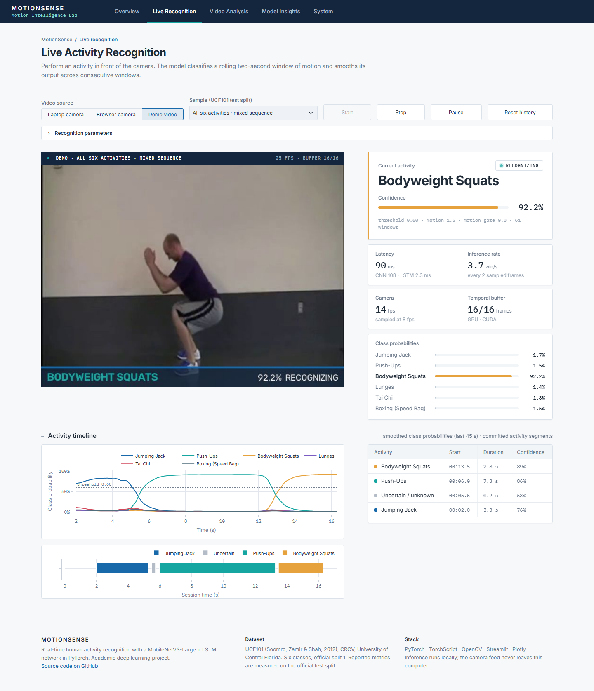
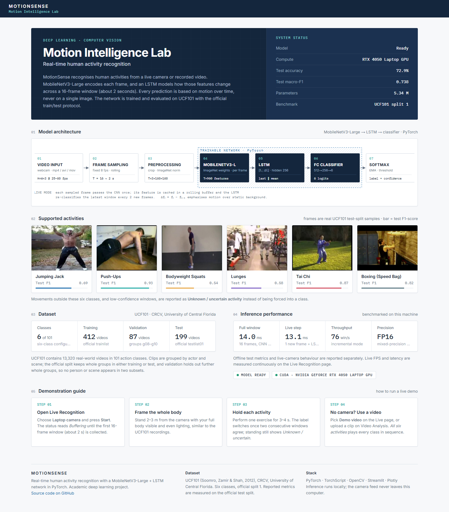
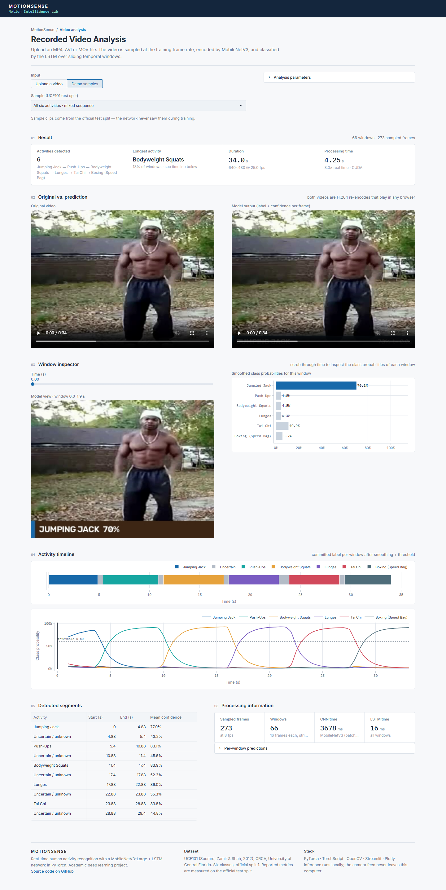
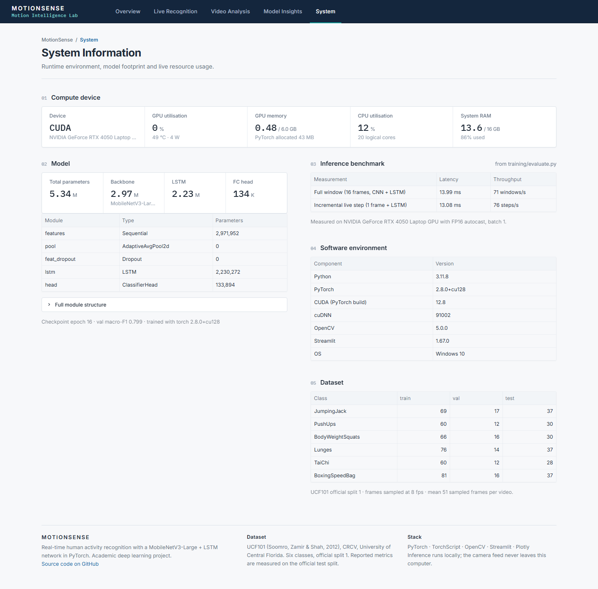

# MotionSense — Motion Intelligence Lab
**Real-time human activity recognition with a MobileNetV3-Large + LSTM network (PyTorch), trained on UCF101.**

MotionSense recognises six human activities (Jumping Jack, Push-Ups, Bodyweight Squats, Lunges, Tai Chi,
Boxing Speed Bag) from a live webcam or an uploaded video. MobileNetV3-Large (ImageNet-pretrained, frozen)
encodes each frame. An LSTM reads a 16-frame window (about 2 s) of those features together with their temporal
differences, and a fully connected head outputs class probabilities. Predictions are therefore based on motion
over time, never on a single frame.



```
VIDEO ─► FRAME SAMPLING (8 fps) ─► PREPROCESS (160², ImageNet norm) ─► MobileNetV3-L (960-d / frame)
      ─► LSTM over [fₜ ; Δfₜ] (hidden 256) ─► [last ‖ mean] ─► FC head ─► Softmax ─► EMA smoothing + threshold
```

## Quick start (trained model included)

```bash
git clone https://github.com/godnix7/MotionSense---Deep-Learning-Project.git
cd MotionSense---Deep-Learning-Project
pip install -r requirements.txt        # installs the CUDA 12.8 build of PyTorch
streamlit run app.py                   # opens http://localhost:8501
```

The trained checkpoint (`checkpoints/motionsense_best.pt`, 21 MB) and all experiment results are in the
repository, so the app works immediately. The dataset is needed only to retrain or to regenerate the demo videos
(see sections 2–5). `python -m data.make_test_data` builds the demo videos once the dataset has been downloaded.

## Screenshots

| Overview | Video analysis |
|---|---|
|  |  |
| **Model insights** | **System** |
|  |  |

## Results (measured, UCF101 split 1, six classes)

| Metric (official **test** split, 199 videos) | Value |
|---|---|
| Video-level accuracy | **72.9 %** |
| Clip-level accuracy (single 16-frame window) | 72.2 % |
| Macro precision / recall / F1 | 0.754 / 0.741 / **0.738** |
| Full-window latency (16 frames, CNN + LSTM, FP16, RTX 4050 Laptop) | 14.0 ms (≈ 71 windows/s) |
| Live pipeline (demo stream, incl. capture, UI and smoothing) | ≈ 30–45 ms per window, 4 windows/s |

Per-class F1: Push-Ups 0.93 · Tai Chi 0.87 · Boxing (Speed Bag) 0.82 · Jumping Jack 0.69 · Lunges 0.58 ·
Bodyweight Squats 0.54. Most errors are Squats ↔ Lunges, two visually similar lower-body exercises.

**Model selection (validation set only):**

| Experiment | Backbone | LSTM input | Best val macro-F1 |
|---|---|---|---|
| baseline | last 4 blocks fine-tuned | fₜ | 0.777 |
| d4 | last 4 blocks fine-tuned | [fₜ ; Δfₜ] | 0.760 |
| d2 | last 2 blocks fine-tuned | [fₜ ; Δfₜ] | 0.797 |
| **d0 (selected)** | frozen | [fₜ ; Δfₜ] | **0.799** |

The baseline's validation errors clustered by UCF101 *group*, which means shared actor and background. In other
words, the network was partly memorising scenes. Two changes reduced this: feeding the LSTM temporal feature
differences Δfₜ = fₜ − fₜ₋₁ (static background cancels out in the difference) and freezing the backbone.
The test split was evaluated **once**, after selection. These numbers are honest results for a small training set
(412 videos), not tuned on test data.

---

## 1. Environment setup

Requirements: Python 3.10–3.12, an NVIDIA GPU with a recent driver (tested on an RTX 4050 Laptop 6 GB), and about 2 GB of disk space.

```bash
python -m venv .venv
.venv\Scripts\activate            # Windows   (Linux/macOS: source .venv/bin/activate)
pip install -r requirements.txt
python -c "import torch; print(torch.__version__, torch.cuda.is_available())"   # must print ...+cu128 True
```

> **Why does PyTorch say CUDA is unavailable?** `pip install torch` from PyPI on Windows installs a CPU-only build
> (`2.x.x+cpu`). `requirements.txt` points pip at the CUDA 12.8 wheel index. If an old CPU build is already present:
> `pip install --force-reinstall torch==2.8.0 torchvision==0.23.0 --index-url https://download.pytorch.org/whl/cu128`

Training refuses to run without CUDA. Pass `--allow-cpu` to override; this is very slow. The app falls back to CPU
with a visible warning, so a demo never crashes.

> **Windows path length:** keep the project in a short path (for example `C:\motionsense`). PyTorch's CUDA DLLs
> inside a virtual environment fail to load (`WinError 206: filename too long`) when the folder path is very deep.
> Using your global Python with the CUDA build installed also works.

## 2. Dataset: UCF101 (six-class configuration)

| Class | UCF101 directory |
|---|---|
| Jumping Jack | `JumpingJack` |
| Push-Ups | `PushUps` |
| Bodyweight Squats | `BodyWeightSquats` |
| Lunges | `Lunges` |
| Tai Chi | `TaiChi` |
| Boxing (Speed Bag) | `BoxingSpeedBag` |

```bash
python -m data.download
```

This downloads the official split files from the source (https://www.crcv.ucf.edu/research/data-sets/ucf101/).
**It downloads only the six classes (~290 MB instead of 6.9 GB).** `UCF101.rar` is a non-solid RAR4
archive whose entries are ordered by class. The script binary-searches the remote archive with HTTP Range requests
to find each class's byte range, downloads only those ranges, and rebuilds a valid reduced archive. WinRAR's
`UnRAR.exe` (or 7-Zip) then extracts it and verifies every file's CRC. Class names are validated against
`classInd.txt` and the extracted directories. Use `--full` to download the entire archive instead.

**Manual fallback:** download `UCF101.rar` and `UCF101TrainTestSplits-RecognitionTask.zip` from the URL above,
put both in `datasets/raw/`, then run `python -m data.download --skip-download`.

## 3. Preprocessing

```bash
python -m data.preprocess
python -m data.samples        # demo clips + overview thumbnails taken from the TEST split
python -m data.make_test_data # browser-playable MP4 test videos in test_data/ (see test_data/README.txt)
```

`test_data/` contains 18 single-activity MP4s (3 per class, from different test-split actors) and
`mixed_activities.mp4`, which plays all six activities back to back (34 s) to demonstrate the timeline. All files
appear under **Demo samples** on the Video Analysis and Live Recognition pages, or you can upload them. The
single-activity set is not filtered: the model gets 13 of 18 right, consistent with the test accuracy.

* Frames are sampled at a **fixed 8 fps**, whatever the source frame rate. The webcam is sampled at the same rate,
  so a 16-frame window always spans about 2 s in both training and live use.
* Frames are resized so the short side is 160 px, then cached as `uint8` arrays (`datasets/frames/`).
* **Splits:** the official `trainlist01` / `testlist01`. Validation holds out whole groups **g08–g10** from the
  training list. UCF101 groups correspond to actor/scene, so no actor or scene appears in more than one subset.
  `preprocess.py` asserts this, which prevents data leakage. The test split is used only by `evaluate.py`.

## 4. Training

```bash
python -m training.train --unfreeze 0   # selected configuration (frozen backbone + feature deltas)
python -m training.train --tag d2 --unfreeze 2   # an experiment, saved to checkpoints/exp_d2.pt
```

About 4–5 minutes on an RTX 4050 Laptop (20 epochs). Data augmentation runs batched on the GPU.

| Setting | Value |
|---|---|
| Backbone | MobileNetV3-Large, ImageNet weights (`IMAGENET1K_V2`); last 4 blocks fine-tuned, earlier blocks frozen (BatchNorm statistics frozen) |
| Temporal model | 1-layer LSTM, hidden 256; the classifier sees [last hidden state ‖ temporal mean] |
| Head | LayerNorm → Dropout → Linear 512→256 → GELU → Dropout → Linear 256→6 |
| Optimizer / loss | AdamW (LR 3e-4 for head/LSTM, 3e-5 for backbone, weight decay 0.01), cosine schedule with warm-up, CrossEntropyLoss (label smoothing 0.1) |
| Augmentation | clip-consistent random resized crop, horizontal flip, brightness/contrast, random grayscale, temporal stride jitter |
| Precision | FP16 mixed precision (autocast + GradScaler) |
| Model selection | best validation macro-F1 → `checkpoints/motionsense_best.pt` (weights + class map + config) |

## 5. Evaluation (official test split)

```bash
python -m training.evaluate
```

This reports video-level accuracy (softmax averaged over 3 clips per video), clip-level accuracy, macro
precision/recall/F1, the confusion matrix and a per-class report. It also benchmarks latency on this machine.
Results are written to `outputs/reports/test_metrics.json`, and static charts to `outputs/charts/`.

## 6. Run the application

```bash
streamlit run app.py
```

| Page | Content |
|---|---|
| Overview | project summary, architecture, supported activities (real UCF101 frames), model status, dataset, performance |
| Live Recognition | webcam feed with the current activity, confidence, status, latency, FPS, class probabilities, and a timeline and history. Start / Stop / Pause / Resume / Reset |
| Video Analysis | MP4 / AVI / MOV upload or demo samples: overall and per-window predictions, a scrubber comparing original frames with model output, and timelines |
| Model Insights | loss and accuracy curves, confusion matrix, classification report, class distribution, training configuration. Every value is read from saved experiment files |
| System | device, live GPU/CPU utilisation (NVML / psutil), parameters, latency benchmark, software versions |

**Live sources**
* **Local camera (OpenCV):** the most reliable option for a demo on the same laptop. It needs no browser permission or WebRTC.
* **Browser camera (WebRTC):** the browser asks for camera permission. Works on `http://localhost`.
* **Demo stream:** plays an official test-split clip in real time through the *same* streaming pipeline and trained
  model. Use it if no webcam is available.

**Privacy.** The server binds to `localhost` only (`.streamlit/config.toml`), so other machines on the network
cannot open the app or see the webcam.

**Why the live page stays fast inside Streamlit.** Two design choices keep Python's GIL from starving inference:
the live video is served as an MJPEG stream from a localhost-only server (`utils/mjpeg.py`), so Streamlit does no
per-frame work; and the per-frame encoder and the sequence head are compiled with TorchScript, so each forward pass
is a single C++ call that runs without holding the GIL. Measured on the laptop webcam inside the app: about 40 ms
latency, 4 windows/s, 24–30 fps camera, versus 280–450 ms with eager PyTorch and per-frame Streamlit images.
The compiled path produces the same probabilities as the eager model (verified: max difference < 1e-4).

**How the live engine works.** Camera frames are sub-sampled to 8 fps. Each sampled frame passes through MobileNetV3
once, and its feature is kept in a rolling 16-frame buffer. Every 2 new frames, the LSTM re-classifies the window.
All of this runs on a background thread, so the video never freezes. Probabilities are smoothed with an EMA. A label
change requires two agreeing windows (hysteresis), which prevents flicker. Below the confidence threshold, or when
there is almost no motion (motion gate), the app shows **UNKNOWN / UNCERTAIN ACTIVITY** instead of forcing a class.
All of these settings can be adjusted on the page.

## 7. Demo tips (live webcam)

* Stand so your **whole body** is in frame, about 2–3 m from the camera, with even lighting. UCF101 clips are mostly
  full-body and third-person.
* Hold each activity for at least 3–4 s. The model needs a full ~2 s window, and smoothing then confirms the change.
* Speed bag and Tai Chi depend on context (the bag; a slow, continuous flow). Push-ups need a side view near the floor.
* Offline test accuracy and live webcam accuracy are **different quantities**. The webcam differs from UCF101 in
  viewpoint, framing, background and clothing. The Model Insights page shows the test numbers; the Live page shows
  live latency and FPS.

## 8. Project structure

```
motionsense/
├── app.py                      Streamlit entry point (top navigation, 5 pages)
├── requirements.txt            CUDA 12.8 PyTorch + app dependencies
├── data/
│   ├── download.py             official splits + selective/complete UCF101 download, extraction, validation
│   ├── preprocess.py           8 fps frame cache, manifest, group-disjoint validation split
│   ├── dataset.py              clip sampling, augmentation, loaders
│   └── samples.py              test-split demo clips + thumbnails
├── models/
│   ├── mobilenet_lstm.py       MobileNetV3-Large + LSTM network
│   ├── classifier.py           fully connected head
│   └── inference.py            model loading, streaming recognizer, video analysis
├── training/
│   ├── train.py                training loop (AdamW, AMP, cosine LR, best-F1 checkpoint)
│   ├── evaluate.py             official test-split evaluation + latency benchmark
│   └── metrics.py              accuracy / precision / recall / F1 / confusion matrix
├── interface/                  page modules, theme, architecture diagram
├── utils/                      config, Plotly/Matplotlib charts, camera sources
├── checkpoints/                trained model
└── outputs/{charts,reports}/   experiment results
```
